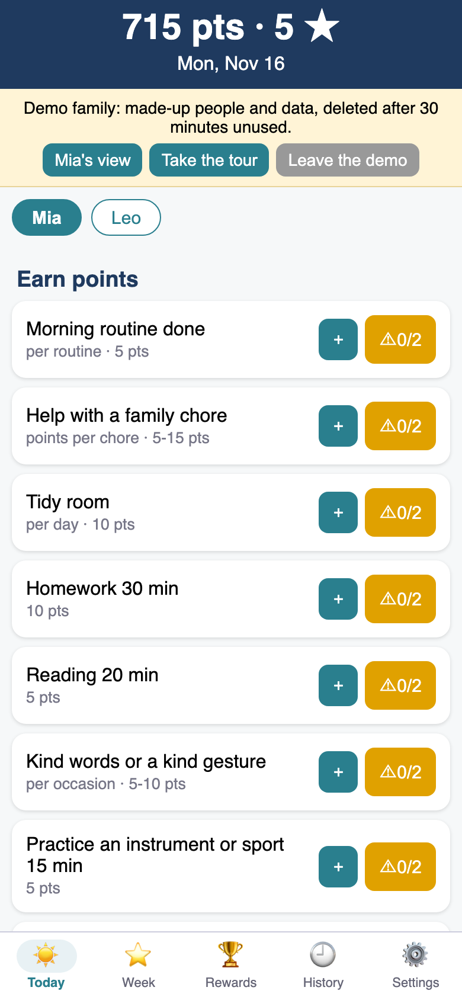
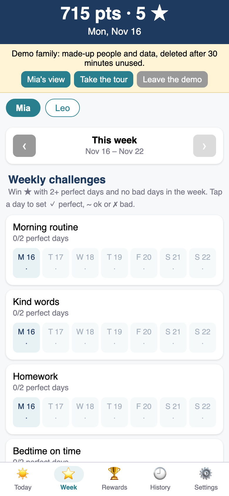
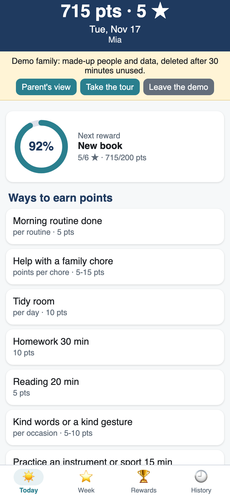
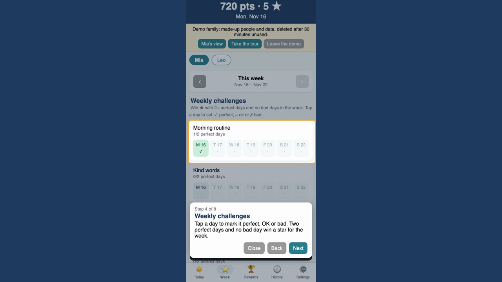

# Little Wins

A points, stars and rewards tracker for families, made for phones.

Parents record good behavior and day-by-day marks on a few weekly challenges. Children watch their points and stars grow toward rewards the family agreed on. The child's view stays positive: it never shows penalties, warnings or parents' notes.

- **Families:** each parent signs in with Google or GitHub; one installation holds one family, or many in hosted mode
- **Several children,** each with their own points, stars and history, switched with a picker
- **Co-parents** join by an invite link; the owner can remove a parent or hand over ownership
- **Children's devices** join with a one-time code or link from a parent, with no password and no account
- **Points** for behaviors, fixed or within a range, with undo
- **Weekly challenges** marked perfect, OK or bad; a good week wins a star
- **Rewards** as milestones of stars and points, with a celebration when one unlocks
- **Past weeks** to look back and fix a mark; each family sets its own time zone and week start
- **Devices** listed in Settings, each one can be logged out
- **A guided tour** for parents and children, and optional **demo families** anyone can try with no sign-in
- One small container, one SQLite file, no third-party scripts or trackers

Project page: [nijaba.github.io/little-wins](https://nijaba.github.io/little-wins/). New to Little Wins? The [user guide](docs/user-guide.md) walks a family through it.

<p>
  
  
  
</p>

### The tour in 30 seconds

[](https://nijaba.github.io/little-wins/tour.mp4)

A parent opens a demo family and walks through the app's built-in tour, with a voice-over. Click the picture to
play the video (MP4, 30 seconds, with sound) from the project page, since GitHub does not play videos kept in a
repository. A running Little Wins also serves it at `/tour.mp4`. The narration is in
[docs/video/tour-voiceover.md](docs/video/tour-voiceover.md). Everyone in it is made up.

## Try it locally

With Node.js 22.13 or newer:

```bash
npm install   # dev tools only; the app has no runtime dependencies
npm run dev
```

Open http://localhost:3000, click **Sign in with Google** and pick a test person on the fake sign-in page, or **Try a demo** for a made-up family. Nothing leaves your machine, and the data lives in a throwaway database under `/tmp`.

Run the tests and the linter:

```bash
npm test
npm run lint
```

## Run it on a server

See [docs/admin-guide.md](docs/admin-guide.md) for Docker setup, updates, backups and troubleshooting.

## Documents

- [User guide](docs/user-guide.md): for families, from sign-in to rewards
- [Design](docs/design.md): how the app behaves, including hosting for other families
- [Build plan](docs/build-plan.md): what's done and what's next
- [Admin guide](docs/admin-guide.md): running your own copy
- [Contributing](CONTRIBUTING.md): how to set up and send a change
- [Security policy](SECURITY.md): how to report a vulnerability
- [Changelog](CHANGELOG.md): what changed
- [docs/video/](docs/video/): the tour video's voice-over script and recording; [docs/images/](docs/images/): pictures for the guides, from a demo family

## License

[Apache-2.0](LICENSE)
