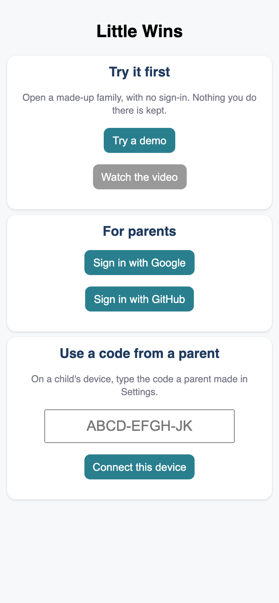
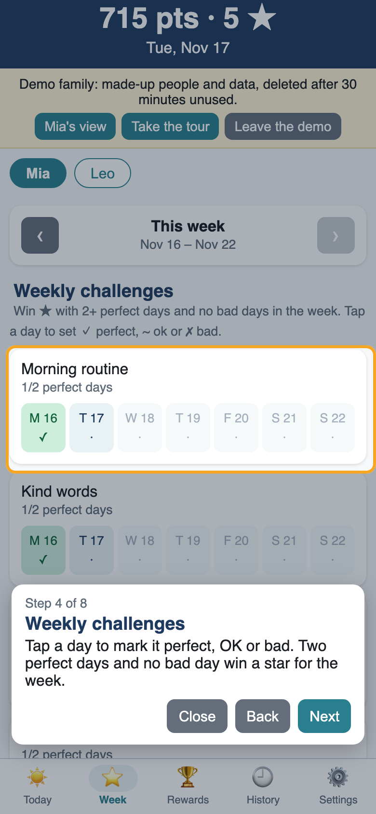
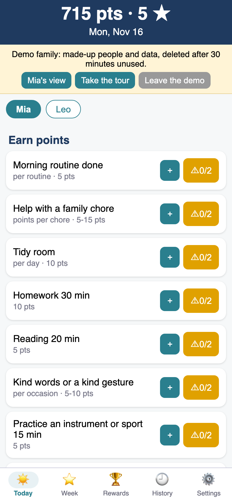
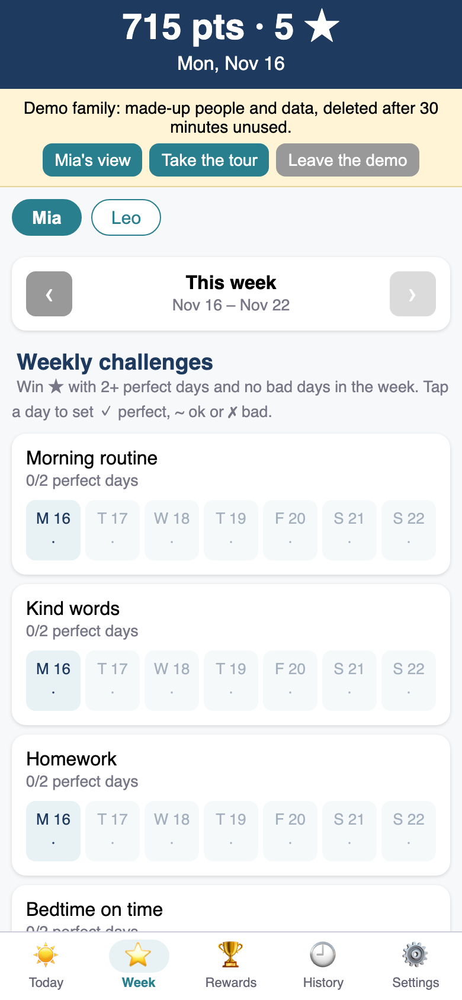
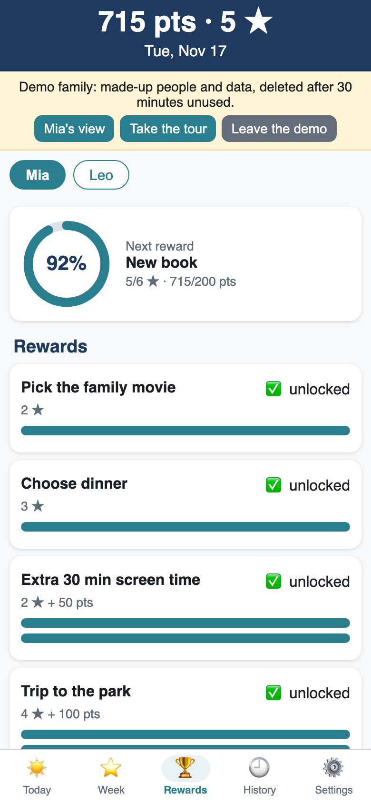
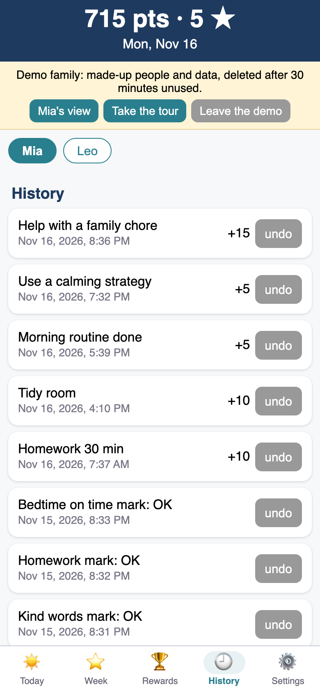
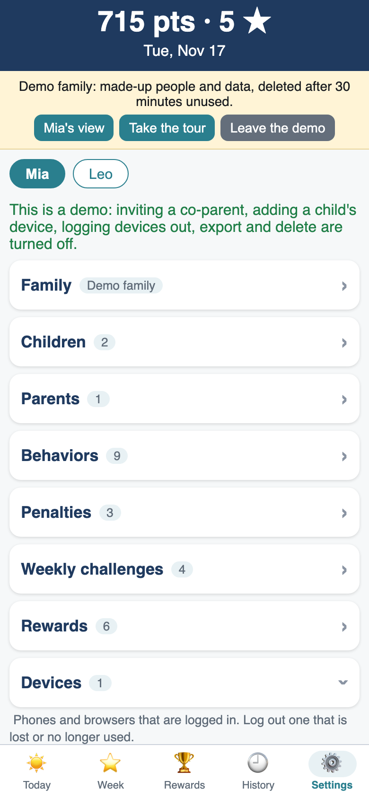
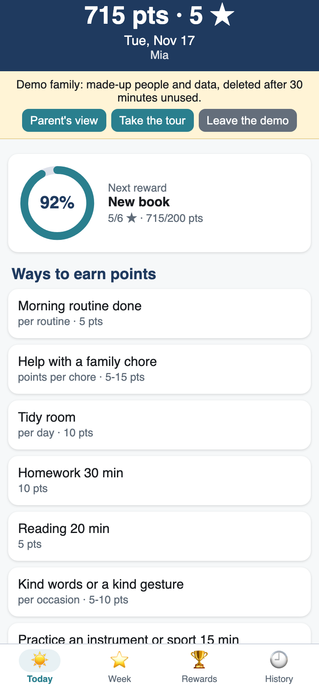
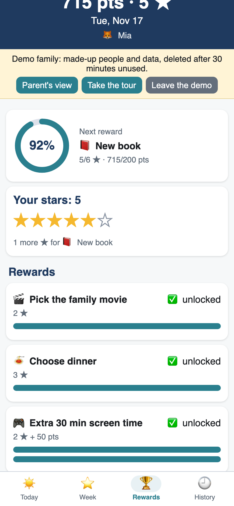

# Little Wins user guide

Little Wins is a points, stars and rewards chart for your family, on your phones. You record the good things
your children do and mark a few weekly challenges day by day. Your children watch their points and stars grow
toward rewards you agreed on together.

This guide is for parents. The last part, [What your child sees](#what-your-child-sees), is worth showing your
children too.

Curious why it works the way it does? [Why Little Wins?](why.md) tells the story behind it.

The pictures come from a demo family: Sam is the parent, Mia and Leo the children. Nobody in them is real.

- [Getting started](#getting-started)
- [Every day](#every-day)
- [Stars and rewards](#stars-and-rewards)
- [Past weeks and History](#past-weeks-and-history)
- [Settings](#settings)
- [What your child sees](#what-your-child-sees)
- [Tips for running a chart well](#tips-for-running-a-chart-well)
- [Questions](#questions)

## Getting started

### Try it first

If the Little Wins you use offers it, **Try a demo** on the sign-in page opens a made-up family, with no
sign-in. You can do everything a parent does day to day, switch to a child's view, and take the tour. Nothing
you do there is kept, and the demo is deleted after a while unused (the yellow banner says how long).
**Watch the video** plays a 30-second narrated tour.

### Sign in

Choose **Sign in with Google** or **Sign in with GitHub**. Little Wins never sees your password: the provider
tells it who you are, and that's all. There is no Little Wins password to remember.

Your account is matched on the provider's own ID for you, never on your email address or name, so changing
either at Google or GitHub doesn't lose your family.

If the page says *This Little Wins is private*, the person running it hasn't let you create a family. Ask
them, or ask a parent who already has a family there for an invite link.

### Set up your family

The first time you sign in, a short form creates your family:

- **Family name:** how the family appears in the app, for example "The Garcias".
- **First child's name:** a first name or a nickname is all the app needs. You add more children later.
- **Time zone** and **Week starts on** (Monday or Sunday): "today" and the weeks follow these, wherever the
  server is. The time zone starts as your phone's.
- **Language:** English, 中文, Español, Français or Deutsch. Every device in the family, your children's too,
  uses it. You can change it later in Settings.
- **Start with a sample list of behaviors and rewards:** a ready-made list in your language that you then edit.
  Leave it ticked unless you want to start from nothing.

Choose **Create**, and you're in.

### The tour

The first time a phone opens your family, a note at the top offers a short tour. **Take the tour** outlines
each part of the app in turn with a sentence on what it's for, switching tabs as it goes: earning points,
warnings, penalties, the weekly challenges, rewards, History, Settings and your child's phone. **Next**,
**Back** and **Done** move through it; Escape or **Close** ends it. **No thanks** hides the note for good on
that phone. You can take the tour again any time from the bottom of **Settings**.

### Add your children

In **Settings → Children**, choose **+ Add child** and type a name. Each child has their own points, stars,
marks and history. With more than one child, buttons with their names appear at the top of every tab: tap one
to choose who you're recording for.

Your family has one list of behaviors, penalties, challenges and rewards. Each one is for all your children
unless you choose some of them in **Settings** (see [Settings](#settings)).

### Add a co-parent

In **Settings → Parents**, choose **Invite a parent**. You get a link to send by **Share** or **Copy**. It works
once and expires in 7 days. The other parent opens it, signs in with their own Google or GitHub account, and
joins your family. Open invites are listed under the button, each with **Cancel**.

The person who created the family is its **owner**. Only the owner can remove a parent, hand ownership to
another parent (**Make owner**), download the family's data and delete the family. Every parent can do
everything else.

### Connect your child's phone

Your child never signs in and never has a password. Instead, a parent connects their device:

1. In **Settings → Devices**, choose **Add a device for** *your child*. (Choose the child at the top first.)
2. The app shows a one-time code, such as `KD7Q-M3XA-PJ`, and a link holding it. It works once and expires in
   10 minutes.
3. On your child's phone or tablet, either open the link (send it with **Share** or **Copy**), or open Little
   Wins, and under **Use a code from a parent** type the code and choose **Connect this device**.

That device now shows that one child, read-only. It can't change anything, and it never shows penalties,
warnings or another child's progress. See [What your child sees](#what-your-child-sees).

If the code has expired, or "didn't work", just make a new one.

### Put it on the home screen

Little Wins works in the browser, but it feels like an app from the home screen, with no address bar:

- **iPhone and iPad (Safari):** the Share button, then **Add to Home Screen**.
- **Android (Chrome):** the ⋮ menu, then **Add to Home screen** or **Install app**.

Do this on your child's device too, after connecting it.

## Every day

The **Today** tab is where you'll spend most of your time. The header always shows the chosen child's points
and stars, and today's date.

### Adding points

Under **Earn points**, tap **+** next to what your child did. A behavior with a fixed number of points adds
them at once. One with a range, such as *5-15 pts*, asks how many; the amount is kept inside the range.

A message at the bottom confirms each entry for a few seconds, with **Undo** if you tapped the wrong one, and
**Note** to add a few words about it, such as "helped grandma with the shopping". Notes are for parents: your
child never sees them.

### A message for your child

At the top of **Today**, **Write <name> a message** leaves a short note for your child, such as "So proud of how you helped your sister today!". It shows at the top of their Today, signed with your name, for a week or until you change or clear it. Unlike the notes on points and warnings, this one is for your child to read.

Little Wins also cheers on its own: **3 perfect days in a row** (or more) and **Best week so far** appear on Today when your child earns them.

### Warnings

The yellow **⚠0/2** button gives a warning on that behavior: a gentle heads-up, such as "that's your first
warning about tidying up". It costs no points. The count goes up for the day (1/2, 2/2) and starts again the
next day. What a second warning means is up to your family.

### Penalties

Further down, under **Penalties**, each one shows the points it takes away. Tap it, confirm, and the points
come off.

- The balance never goes below 0. A penalty on an empty balance takes what's there, and doesn't leave a debt
  to pay off later.
- Children never see penalties or warnings, on their own device or anywhere else. They see their points go
  down, but not why. Talk to them about it instead.

### Weekly challenges

The **Week** tab lists your weekly challenges, such as "no screens at dinner", with a box for each day of the
week. Tap a day to mark it: ✓ perfect, then ~ OK, then ✗ bad, then back to ✓. Days still to come are locked.

Under each challenge, the app tells you how the week is going: *1/2 perfect days*, *a bad day*, or **★ won**.

## Stars and rewards

### How stars are won

A challenge wins a star for the week with **at least 2 perfect days and no bad day**. Four challenges can win
up to four stars a week.

Stars are always worked out again from the marks, so fixing a mark, even weeks later, fixes the stars too.

### Rewards

The **Rewards** tab lists your family's rewards and what each needs: a number of stars, points, or both. A
reward unlocks once your child has both. Rewards are milestones, so nothing is spent: unlocking one doesn't
take away stars or points, and the next reward simply needs more.

The ring at the top shows how close the next reward is. When one unlocks, each phone in the family shows a
small celebration the first time it sees it.

How you hand over the reward itself (the cinema trip, the new book) is up to you.

## Past weeks and History

### Fixing last week

On the **Week** tab, the arrows beside the week's date go back through past weeks, to the first week with
anything in it. Tap a day to fix it, just like this week. **Back to this week** returns. So if you forgot to
mark Sunday, you can still do it on Monday morning.

### The weekly review

At the bottom of the **Week** tab, **Weekly review** sums up the chosen child's week: stars won, points earned and lost, warnings, perfect and bad days, points by day, each challenge, what they did most often, and the last four weeks side by side. Use the arrows to look at another week. **Print** prints it, or saves it as a PDF, which is handy for a counselor or a teacher.

### History and undo

The **History** tab lists everything recorded for the chosen child, newest first: points, warnings, penalties
and marks, with who recorded each. **undo** removes an entry, and the balance is worked out again from what's
left. Undoing a mark clears it. **note** adds, changes or removes the note on points, a penalty or a warning
(leave it empty to remove it); the note shows under the entry.

## Settings

Everything in **Settings** is in folding sections. Each header shows a count; tap it to open.

- **Family:** the family's name, time zone, which day the week starts, and the language. **Save** applies them
  to every device in the family.
- **Children:** **🔔 Notices on their device** lets your child's phone or tablet get a notice when they unlock
  a reward or reach a milestone ("⭐ You unlocked New book!"). Turn it on here, then tap **Turn on
  notifications** on their device. Only good news is ever sent. Rename a child, add one, or delete one (with all their history, after a confirmation; a family
  keeps at least one child).
- **Parents:** who's in the family, invites, and for the owner, **Make owner** and **Remove**.
- **Behaviors, Penalties, Weekly challenges, Rewards:** **Edit** changes one, **+ Add** creates one, ▲ and ▼
  change the order, ✕ removes one. Each can have an **emoji**, such as 🧹 for "Tidy room" or 🍦 for a treat: tap one
  in the form or paste your own. Children get one too (Settings → Children → Rename), shown next to their name. It
  makes the lists easier to read, especially for younger children. With more than one child, **Who is it for?** lets you keep one for some
  children only, such as piano practice for one and swimming for another: the others don't see it on their
  Today, Week or Rewards. Settings shows "For: …" under those. A behavior has a name, a short note (such as "per day") and its points: the
  same number twice for a fixed amount, or a minimum and a maximum for a range. Removing a behavior, penalty or
  challenge hides it but keeps the history that used it.
- **Evening reminder** (on your own phone): a daily nudge at the time you choose, such as 19:30, to mark the
  day's challenges. It only comes when something is still unmarked, and says nothing about your children.
  Turn it on on each phone you want it on. On iPhone, add Little Wins to the Home Screen first and open it
  from there. It goes through your phone maker's push service (Apple, Google or Mozilla), which can't read it.
- **Devices:** every phone and browser logged in to your family, parents' and children's, with when each was
  last used. **Log out** one that's lost, sold or no longer used; a child's device then needs a new code.
  **Add a device for** *child* is here too.
- **Download all our data** (owner): everything about your family, in one file (JSON).
- **Delete this family** (owner): deletes all children, history, lists and devices for everyone, at once. Type
  the family name to confirm. It can't be undone, so download your data first.
- **Sign out** logs this phone out. **Take the tour** starts the tour again.

If the Little Wins you use is run by someone else for many families, **Privacy** and **Terms** links on the
sign-in page and in Settings lead to their policies.

## What your child sees

Your child's device shows only their own progress, and only the positive parts.

- **Today:** your message, if you left one, and any milestone they reached; their points and stars, their
  name, the next reward with its ring, and the ways to earn points (to look at: there are no buttons).
- **Week:** this week's challenges and marks, and past weeks, read-only.
- **Rewards:** every reward and what it needs, with the ones they've unlocked.
- **History:** the points they earned and their marks.

On their Week, perfect days are gold star stickers and a week that wins a star is stamped "⭐ won!". Their Rewards
open with a jar of the stars they've earned and how many more the next reward needs.

When you've added points since they last looked, their points count up on the screen, and a reward unlocking
brings a small burst of confetti. The ring glows when the next reward is nearly theirs.

It **never** shows penalties, warnings, Settings, the other parents, or a brother's or sister's progress. It
can't record anything: a child can look, but only a parent can change things.

To see exactly what your child sees, try the demo and choose *child*'s view in the yellow banner.

## Tips for running a chart well

- **Start small.** Three to five behaviors and two or three weekly challenges are plenty. Add more once the
  routine sticks.
- **Choose rewards together.** Children work harder for a reward they picked. Mix small, quick ones (a few
  stars) with a bigger one to save for.
- **Be specific.** "Tidy room" works better with a note that says what tidy means: "toys away, clothes in the
  basket".
- **Catch them being good.** Record points soon after the good moment, and say it out loud. The app is a
  reminder to notice, not a replacement for praise.
- **Warnings before penalties.** A warning gives a chance to change course. Keep penalties rare, and explain
  them face to face, since your child won't see them in the app.
- **Two perfect days, not seven.** The star rule rewards a good week without asking for perfection. A bad day
  costs that week's star, and next week is a fresh start.
- **Look back together.** Once a week, open the Week and Rewards tabs side by side with your child and talk about
  what went well.
- **Keep it consistent between parents.** Agree what earns points and what a warning means, so the chart says
  the same thing whoever is holding the phone.

## Questions

**Is my children's data private?**
Little Wins stores a first name or nickname for each child, what you record, and your sign-in. No birthdates,
photos or contact details. There are no ads, analytics or trackers, and nothing is sent to anyone else. Your
children never type anything. The owner can download everything and delete the family at any time.

**We changed phones.** Sign in again on the new one. For a child's device, make a new code in **Settings →
Devices**, and log out the old device there.

**A child's device says to ask a parent for a new code.** It was logged out, or its code was already used or
expired. Make a new one in **Settings → Devices**.

**The points look wrong.** Check **History**: every change is there, with who made it, and **undo** fixes a
mistake. Remember the balance never goes below 0: a penalty on a low balance only takes what's there.

**Stars changed by themselves.** Someone fixed a mark in a past week (it's in **History**). Stars are always
counted again from the marks.

**Is there a dark mode?** Yes: Little Wins follows your phone's light or dark setting.

**Can two parents use it at the same time?** Yes. Each phone refreshes every few seconds, so changes from the
other parent show up on their own.

**We want to stop.** The owner can **Download all our data**, then **Delete this family** in Settings.

Running your own Little Wins? See the [admin guide](admin-guide.md).
